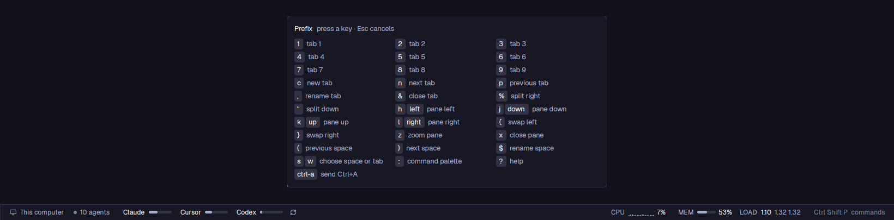

# Status and prefix keys

Herdr's main layout with one status bar that also shows plan usage for
Claude, Codex, OpenCode and Cursor, and this computer's CPU, memory and
load. tmux-style prefix keys (Ctrl+A, then a key) and Catppuccin Latte and
Mocha themes come with it.

## What you see

- **The window:** Herdr's `main` layout (spaces and agents on the left,
  tabs, panes as cards), with its status block replaced by `usage`.
- **The status bar** (28px, `chrome` background, top border `border`,
  text 11.8px `muted`), left to right:
  1. **Where you are:** the machine (monitor or server icon) and the
     branch, as the shipped `workspace-status` shows them. Then "N agents",
     and "· N needs you" in `blocked` when an agent is blocked.
  2. **One segment per AI service that has numbers:** its name and a
     40×5px meter of its fullest limit window. The meter fill is `muted`,
     `ansi3` from 60% used and `ansi1` from 80%. A yellow `!` follows
     when the last read failed. The service closest to a limit comes
     first. A `refresh` icon follows, and it spins during a read.
  3. **This computer** (on the right):
     - `CPU`: a sparkline of the last 16 samples (2×≤11px bars, oldest
       on the left), then the percentage;
     - `MEM`: a 32×5px meter and the percentage used;
     - `LOAD`: the 1-, 5- and 15-minute load averages.

     Warning colors: CPU at 75%, memory at 80%, load per core at 75%. All
     turn red at 90%. Hovering shows the core count, memory in GB and
     uptime.
  4. **The palette hint:** the key bound to `app.palette` plus
     "commands". It is read from `keys()`.
- **The usage popup** (340px, a click on a service segment):
  - **Header:** the name and "Updated N ago", with the email and plan on
    the right.
  - **Errors** in `ansi3`.
  - **One block per window:** "Weekly 95% left", "Resets in 6d 19h" and a
    6px bar of what is left. A 2×10px tick marks where an even spend
    would be. Below it: "N% in reserve" / "N% in deficit" / "On pace",
    then "Lasts until reset" or "Runs out in X".
  - **Then** the balances and sections, separated by 1px lines.
  - **Rows:** Refresh and Usage Dashboard.
- **The prefix popup** (560px, at the top): nothing for 600ms. After
  that, every binding as key chips and labels in three columns.

## How it behaves

- **Usage reads** come from the services' own usage endpoints, using the
  sign-ins their CLIs saved:
  - Claude: `~/.claude/.credentials.json`;
  - Codex: `~/.codex/auth.json`, or opencode's OpenAI sign-in;
  - OpenCode Go: opencode's `auth.json`, or `OPENCODE_API_KEY`;
  - Cursor: its `state.vscdb`, read with `sqlite3`.

  A service that is not signed in is left out. Each service is read every
  10 minutes. After a rate limit the next read waits 30 minutes, and after
  an error it waits 5 minutes. A rejected sign-in waits twice as long each
  time, up to 6 hours. A failed read keeps the last numbers. The popup's
  Refresh reads that one service right away, but never twice within 10
  seconds.
- **The popup** is a second copy of the `usage` mod (with `props.panel`).
  Only the bar copy reads the services, and it shares the readings through
  `shared("usage")`.
- **System load** is read every 2 seconds from `/proc`, so it is Linux
  only. CPU is the change in busy ticks over the change in total ticks
  between two samples.
- **Prefix keys:** `ctrl-a` runs `mod.open:prefix`. The popup takes the
  keyboard, runs the action that `bindings.json` gives the next key, and
  closes. Esc or an unbound key cancels. `ctrl-a` twice sends Ctrl+A on
  to the focused terminal (`hc keys <t> ctrl+a`).

## Built from

- `layouts/herdr-dfg.json`: a clone of `main` whose `status` block holds
  `{ "mod": "usage" }`.
- `mods/usage/`:
  - `main.js`: the bar and the popup;
  - `providers.js`: the services' requests and parsers (pure, with
    injected I/O);
  - `service.js`: the read schedule;
  - `format.js`: the countdown and pace maths;
  - `system.js`: the `/proc` sampling.

  It uses these `herdr` functions: `exec`, `readTextFile`, `fetch`,
  `shared`/`setShared`, `nextCommand` (`usage.refresh`), `openOverlay`,
  `spaces`, `agents`, `keys`, `run`.
- `mods/prefix/`: `main.js` and `bindings.json`. Each entry is
  `key: [action, label]`, where the action is written as in `keys.json`
  (`"pane.split:right"`) or is `"send-prefix"`.
- `themes/catppuccin-{latte,mocha}.json`: Catppuccin's official palette,
  with window colors mapped to crust, mantle, surface and overlay and
  `accent` set to mauve.
- The status bar icons come from the shipped `workspace-chrome` mod.
  `refresh.svg` and `chart.svg` are Lucide icons.

## Watch out

- **Undocumented endpoints:** the usage endpoints are undocumented, and
  the requests send the clients' own headers (for example Claude Code's
  `User-Agent` and `anthropic-beta`). A service can change or block them.
- **Docking:** a mod's `mod.json` `place` docks it only the first time
  Herdr sees the folder. Put `usage` into a layout by editing the layout.
- **Popup focus:** a popup does not take the keyboard by itself. The
  prefix mod focuses itself on the first frame.
- **Key order:** JSON object order puts the digit keys first in the
  reminder.
- **Line start:** Ctrl+A as the prefix hides it from programs. Shells use
  it for "start of line", so press it twice or use Home.

## Done when

- `herdr-app check mods/usage` and `herdr-app check mods/prefix` pass.
- The bar shows a meter for each signed-in service and CPU, MEM and LOAD.
  The CPU sparkline fills in about 30 seconds.
- Clicking a service opens its popup with pace lines.
  `herdr-app do usage.refresh` updates "Updated N ago".
- Ctrl+A then `%` splits the pane to the right. Ctrl+A then a pause shows
  the binding list.
- Settings → Look lists Catppuccin Latte and Mocha.
